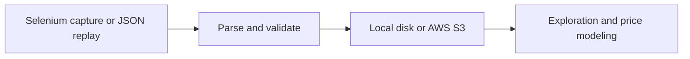

# Used-Car Listings Pipeline · Python and AWS S3

A batch pipeline for Brazilian used-car listings, from Selenium capture to an auditable dataset for pricing analysis. Replay a synthetic capture locally to reproduce the processing, validation and storage flow.

## Architecture



Each batch writes the source capture, the curated CSV, rejected-card positions and reasons, and a manifest with counts and SHA-256 checksums. The batch ID is derived from the output bytes. Replaying the same capture with the same processing produces the same artifacts and logical keys. The manifest is written after the batch artifacts, then the latest CSV is published for the existing notebooks. An empty, invalid or interrupted batch leaves the previous latest CSV available if it fails before that final write.

The parser checks positive prices in Brazilian format, year, state, and mileage when present. A missing odometer stays null. Explicit transmission terms identify automatic and manual listings. Other descriptions stay unknown. Deduplication uses identical curated fields within each batch. Listings with identical attributes can represent distinct vehicles.

## Run the local demo

Validated with Python 3.12. The demo uses synthetic listing text and forces local storage.

```bash
python3 -m venv .venv
source .venv/bin/activate
python -m pip install -r requirements-dev.txt
python -m src.scraper --fixture tests/fixtures/listings.json --output-dir data
python -m ruff check src tests
python -m pytest -q
```

The measured replay produced **15 captured, 12 accepted, 2 rejected, 1 duplicate**, and **1 missing odometer** among accepted listings. The module and script entry points produced identical manifests in the replay. All code cells in both notebooks were executed in IPython using the resulting CSV. [Demo manifest](evidence/demo-manifest.json)

### Browse live listings

With Chrome installed and permission to access the source, run:

```bash
python -m src.scraper --live --pages 2 --output-dir data
```

The collector waits for visible cards and uses bounded paging with delays. It reports a timeout if the expected cards are missing. The Selenium flow was exercised with a test double. The current live page layout requires a separate smoke check. [Source](https://www.icarros.com.br/)

## Storage options

| Mode | Configuration |
|---|---|
| Local | `AMBIENTE=LOCAL` (default). `DATA_DIR` overrides the repository's `data/` directory. `--output-dir` explicitly selects local output. |
| AWS S3 | `AMBIENTE=PROD`, `BUCKET_NAME` set to an existing bucket, optional `S3_PREFIX` and `AWS_REGION`. The SDK resolves credentials from its normal provider chain, including profiles and roles. |

See [.env.example](.env.example) for variable names. For S3, scope the runtime role or profile to `s3:PutObject` and `s3:GetObject` for the chosen prefix, and configure bucket access separately. The S3 contract test uses Botocore's Stubber to verify object keys, content type and CSV round-trip without calling AWS. This release has evidence for local runs and the SDK contract. Bucket provisioning and live S3 writes are outside that validation. [Boto3 credentials](https://docs.aws.amazon.com/boto3/latest/guide/credentials.html) · [S3 PutObject](https://docs.aws.amazon.com/boto3/latest/reference/services/s3/client/put_object.html)

Use a single writer per output directory or prefix. Per-object writes and the batch manifest provide a way to distinguish complete batches from partial runs. The latest CSV and the batch files are separate writes.

## Notebooks

- [Exploration](notebooks/01_analise_exploratoria.ipynb) summarizes listing prices and vehicle attributes.
- [Price modeling](notebooks/02_machine_learning.ipynb) compares Random Forest with a training-median baseline on a held-out split. The preprocessing pipeline is fit on the training set. K-Means is separate descriptive analysis.

The target is the asking price. The demo's synthetic metrics exercise the modeling workflow. Market performance needs real data and a time-based evaluation.

```bash
python -m ipykernel install --sys-prefix --name cars-portfolio
AMBIENTE=LOCAL DATA_DIR="$PWD/data" python -m nbconvert --to notebook --execute \
  --ExecutePreprocessor.kernel_name=cars-portfolio \
  --output-dir work/notebooks notebooks/*.ipynb
```
